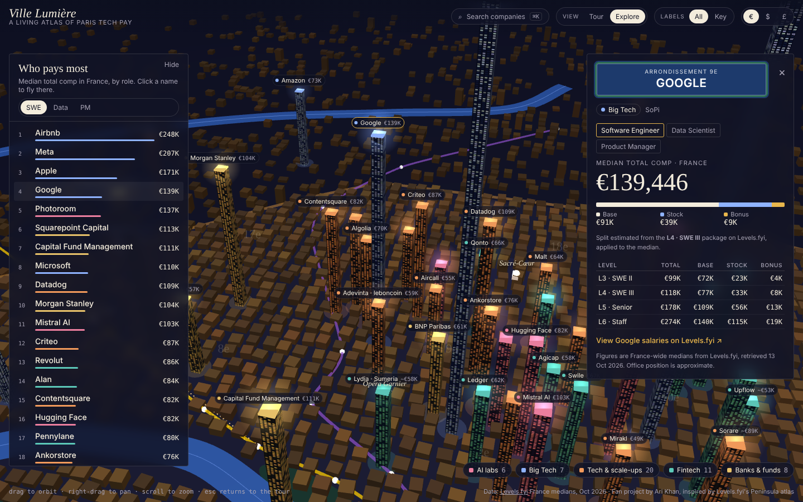

# Ville Lumière

A living 3D atlas of Paris tech pay. 52 AI, Big Tech, scale-up, fintech and finance companies glow as towers across a night-time Paris, each one as tall as its median engineer pay in France.



## What you can do

- **Tour** – scroll through 10 chapters, from La Défense through SoPi, Silicon Sentier and Canal Saint-Martin to the Left Bank and the suburbs.
- **Ride the Métro** – follow Line 1 or Line 14 with live "next station" updates.
- **Explore** – orbit freely, rank companies by role (SWE, data, PM), filter by sector.
- **Company cards** – median total comp, base / stock / bonus split and per-level pay, with a link to the company on Levels.fyi.
- Search with ⌘K / Ctrl+K, switch € / $ / £, toggle all or key labels.

## Run it

No build step. Open `index.html` in a browser, or serve the folder:

```bash
python3 -m http.server 8000
# then open http://localhost:8000
```

## Project structure

| File | What it holds |
| --- | --- |
| `index.html` | Layout and styles |
| `data.js` | Companies, pay data, Seine and Métro geometry, tour chapters |
| `main.js` | three.js scene, tour camera, Métro ride, labels, cards, search |

Built with [three.js](https://threejs.org) r128.

## Data

Pay figures are France-wide medians from [Levels.fyi](https://www.levels.fyi), retrieved 13 October 2026. Levels.fyi does not publish Paris-only company figures, so these cover all French submissions. Where Levels.fyi keeps a median locked, the card shows its common range instead. Office positions are approximate (neighbourhood level). $ and £ use indicative conversion rates.

## Credits

Inspired by [The Peninsula](https://www.levels.fyi/atlas), Levels.fyi's 3D atlas of Silicon Valley. This is an independent fan project, not affiliated with Levels.fyi.

Made by Ari Khan.
